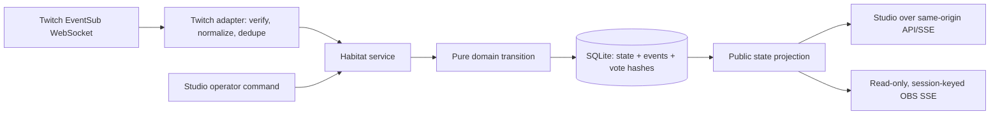

# Habitat Relay — Architecture & Safety Decisions

**Status:** implemented for the local, single-operator build. This is not a production hosting approval.

## Decisions

| Area | Decision | Reason / constraint |
|---|---|---|
| Runtime | Node.js 20+ with native HTTP APIs, browser-native JavaScript, SQLite (`better-sqlite3`) | Small local-first deployment, no client build pipeline or external UI runtime. |
| Boundaries | Pure scenario/domain reducer; application service coordinates commands, dedupe and persistence; Twitch, SQLite and HTTP remain adapters | Keeps game transitions deterministic and testable offline. |
| Voting | One normalized vote per session/round/hashed actor; provider delivery IDs are unique; no chat replies | Avoids duplicate tallying and minimizes chat-data exposure. |
| Decisions | Plurality is proposed only. Tie/no-vote requires operator selection; every outcome requires explicit operator approval. | Chat participation cannot bypass streamer control. |
| Timers | Server-owned deadlines use an injected monotonic clock; wall timestamps are audit/display data. Pause stores remaining time; reconnect pauses live rounds until the channel is ready and an operator resumes. | Client clock changes and reconnect gaps must not consume or extend a round silently. |
| Persistence | SQLite snapshot, events and vote dedupe are committed transactionally with revision checks. Reset is destructive and confirmed. | Recoverable local session, race protection and auditable aggregate transitions. |
| Twitch | Installed-chat reader using OAuth authorization code and EventSub WebSocket; request only `user:read:chat`; encrypt stored tokens with AES-256-GCM; never send chat messages. | Minimal chat access and no secrets in browser/overlay. Protocol is mocked in tests; live acceptance is excluded. |
| Overlay | Separate read-only snapshot/SSE surface; random session-scoped capability URL, reset-revocable; never includes operator actions, raw chat, or actor identifiers. | OBS can render a shared view without an operator credential. Treat URL as a secret. |
| Operator security | Same-origin validation on mutating routes; local single-operator assumption. `/api/operator/overlay-link` is unauthenticated. | Sufficient for trusted local use only; not safe as a public multi-user deployment. |
| Content | Versioned scenario JSON, schema-validated; source/action links restricted to HTTPS; authored numeric indicators and fictional resource costs. | Show provenance without representing authored game state as ecological measurement. |
| Fictional budget | Six game-only field tokens; costs range from one to three and are shown before each option; deduction occurs only on streamer approval; undo restores the exact prior balance; discard costs nothing. For example, choosing the two-token path in both early rounds leaves only two, so the three-token final route is unavailable and chat/operator must choose the one-token seasonal route. | Gives bounded game trade-offs without implying money, physical materials, or actual restoration capacity. |
| Recap | Markdown and schema-versioned JSON; aggregate votes, sources, costs and scenario state only; no user identifiers or chat text. | Portable session notes with explicit simulation disclaimer. |

## Event and data flow



## State transitions

```text
ready --start demo / confirmed-ready live--> voting
voting --timer / close early-------------> review
review --choose if tie/empty; approve----> next voting round or complete
voting or review --pause-----------------> paused
paused --resume (live only if chat ready)-> previous phase
voting or review --discard---------------> next round or complete (no effects/cost)
voting after last commit, no new votes --> safe undo returns to prior review state and refund
any active state --confirmed reset-------> ready; rotate/revoke overlay link
```

A vote does not change metrics or spend tokens. Commitment is the single transaction boundary for applying authored effects and fictional token costs.

## Security boundary and deployment caveat

This build is intended to run on the operator’s trusted local machine. Same-origin checks mitigate cross-site state changes but do not authenticate the operator. Because the overlay-link mint endpoint has no operator authentication, do not expose the server publicly or use a shared preview with a real Twitch credential. A hosted multi-user service needs authenticated operator sessions, TLS, edge rate limits, secret rotation, database backup/retention policy, and a separately reviewed capability-link design.

## Explicit verification exclusion

No real Twitch application credentials, OAuth authorization, broadcaster account, or live channel chat acceptance was used. Twitch tests use protocol mocks. This is not evidence of real Twitch connectivity; the live authorization/chat acceptance remains intentionally unperformed.
